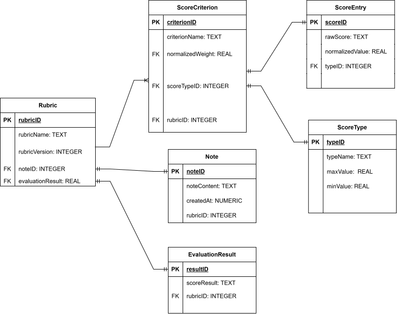

# Entity-Relationship Model

This document outlines the data persistence schema and relational model for **SLPEntry**. The architecture separates core rubric definitions, scoring criteria, and policy constraints to support customizable evaluation frameworks for Speech-Language Pathologists (SLPs).

## Schema Overview

### Key Entities & Domain Constraints

* **Rubric:** The parent container for custom clinical evaluation templates, mapped by unique identifiers and diagnostic categories.
* **ScoreCriterion & ScoreType:** Defines assessment criteria, weighted scoring thresholds, and diagnostic types across domain evaluations.
