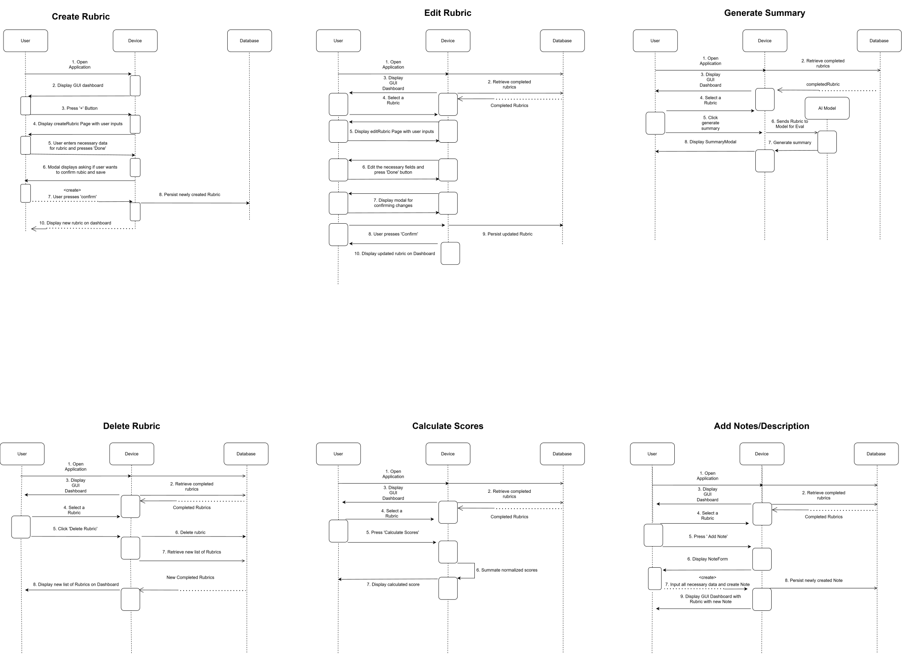
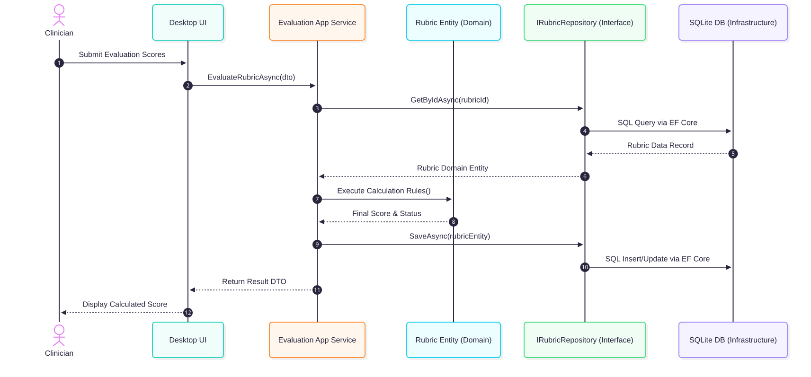

# Sequence Workflows & CRUD Operations

This document details the step-by-step application control flow across core CRUD use cases and score calculation workflows in **SLPEntry**.

### Covered Operations

1. **Create Rubric:** Orchestrates input validation, template construction, and local persistence.
2. **Edit & Delete Rubric:** Manages mutation lifecycles and state integrity across rubric criteria.
3. **Calculate Scores:** Processes clinician inputs against `ScorePolicy` rules to output normalized diagnostic metrics.
4. **Generate Summary & Add Notes:** Formats evaluation outputs for clinical reports and history logs.

## Calculation Workflow Diagram

