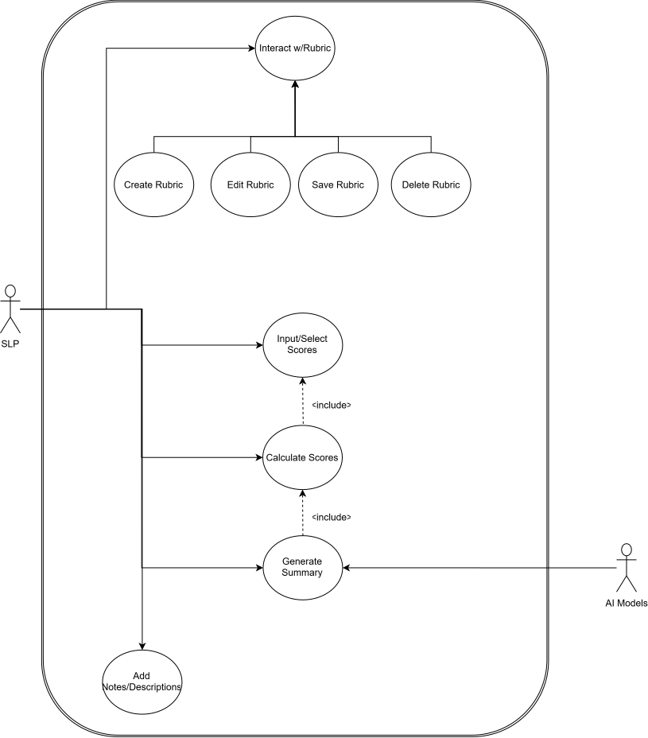

# Use Case & System Boundaries

This document defines actor responsibilities and system boundary interactions for clinical evaluations managed within **SLPEntry**.

## System Boundary Diagram

### Core Actor Capabilities

* **Speech-Language Pathologist (SLP):** Constructs customized evaluation rubrics, inputs diagnostic assessment data, triggers calculation engines, and exports structured report summaries.